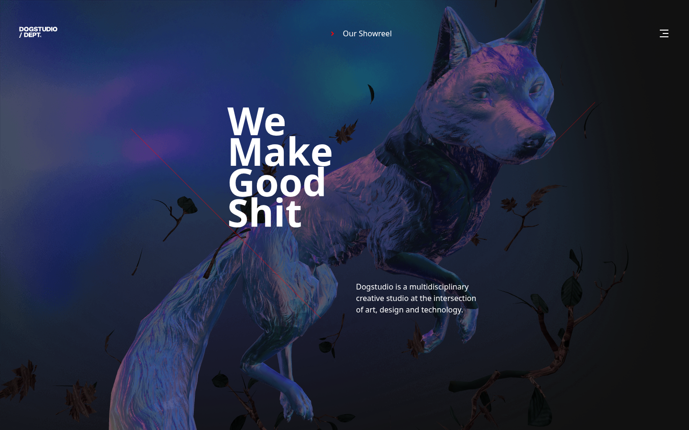
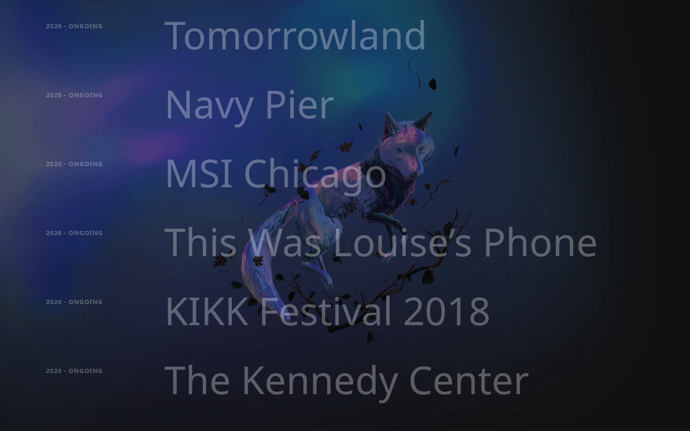
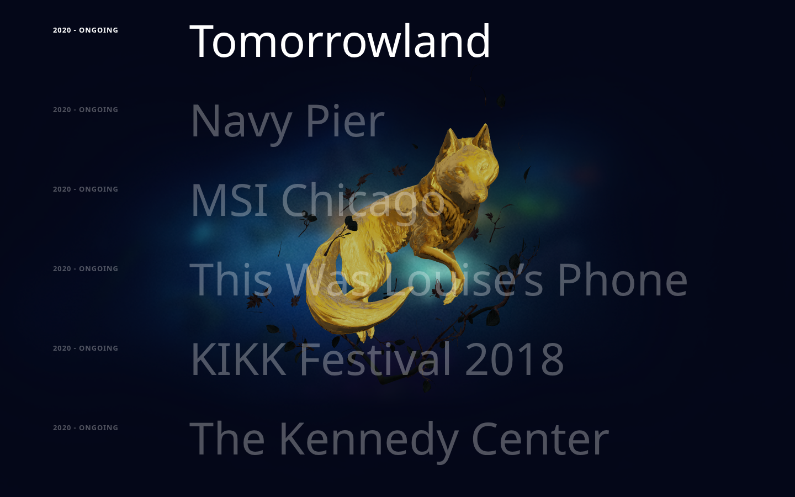
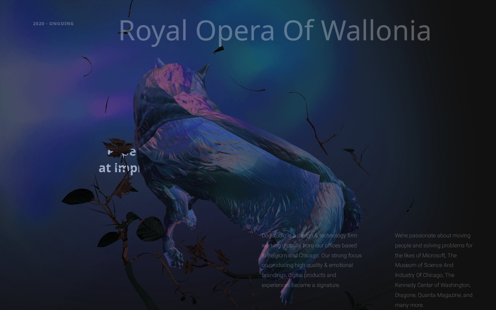
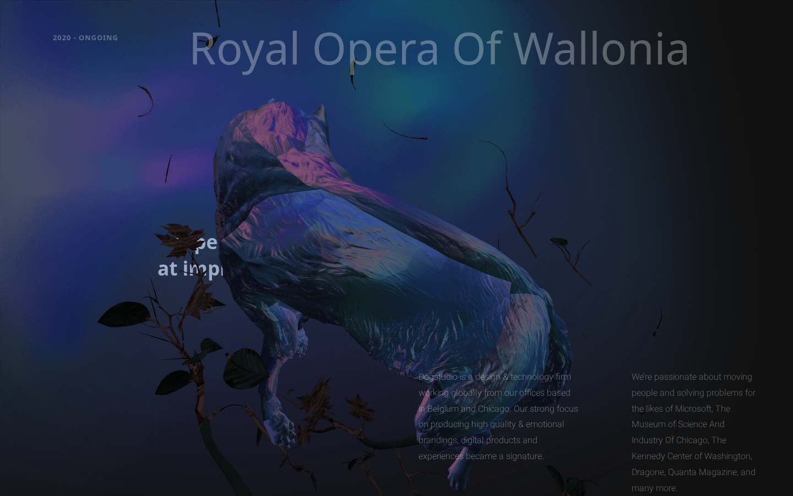

# First 3D Project — Interactive Dogstudio Recreation

An interactive 3D web experience built with **React 19**, **Three.js**, **React Three Fiber (R3F)**, and **GSAP ScrollTrigger**. This project is an independent educational study recreating the iconic 3D mascot and portfolio showcase of [Dogstudio](https://dogstudio.co/).

---

## Project Badges


---

## Live Demo & Repository

- **Live Website:** [https://first-3d-project-eight.vercel.app/](https://first-3d-project-eight.vercel.app/)
- **GitHub Repository:** [https://github.com/Abu-Fazal/first-3d-project](https://github.com/Abu-Fazal/first-3d-project)
- **Original Inspiration:** [https://dogstudio.co/](https://dogstudio.co/)

---

## Project Preview



---

## About the Project

**First 3D Project** marks my first practical exploration into the world of real-time 3D web graphics. To understand how modern creative agencies build immersive, award-winning web experiences, I chose to recreate the signature aesthetic of Dogstudio's celebrated website.

The application mounts a full-viewport WebGL canvas behind DOM content, rendering a skeletal-animated 3D dog resting among branches and leaves. As the visitor scrolls, the camera perspective shifts and the 3D model transforms smoothly along multiple axes. In the portfolio section, hovering over individual project titles triggers a dual transition: the DOM background cross-fades to high-resolution project artwork, while a custom GLSL shader executes a smooth diagonal wipe across the 3D model to swap its reflective matcap texture.

> **Disclaimer:** This project is an independent, non-commercial educational study created solely for learning and skill development. It is not an official Dogstudio project and is not affiliated with or endorsed by Dogstudio.

---

## Project Objective & Learning Purpose

The core learning objectives behind this build were:

1. **Master 3D Foundations on the Web:** Learn how WebGL contexts, cameras, geometry, and lighting work via Three.js.
2. **Bridge React with Three.js:** Understand component-based 3D scene graphs using `@react-three/fiber` and `@react-three/drei`.
3. **Custom Shader Engineering:** Go beyond out-of-the-box materials by injecting custom GLSL fragment shaders via `onBeforeCompile` to build coordinate-aware material transitions.
4. **Scroll-Driven 3D Choreography:** Coordinate camera depth, pitch, and yaw rotations with vertical DOM scroll position using GSAP ScrollTrigger.
5. **Modern Layout & CSS Interaction:** Leverage modern CSS features (including CSS nesting and parent `:has()` selectors) to coordinate DOM state with WebGL rendering.
6. **Performance Optimization:** Understand asset optimization pipelines including Draco geometry compression and spherical Matcap reflections.

---

## Inspiration — Dogstudio

[Dogstudio](https://dogstudio.co/) is a renowned multidisciplinary creative design and technology agency based in Belgium and Chicago. Their original agency website introduced a real-time 3D dog mascot that wags its tail, reacts to sound, and shifts materials across portfolio items.

This recreation pays homage to their creative concept:
- **Recreated Elements:** Hero layout ("We Make Good Shit"), typography structure, resting 3D dog model, case-study list, and diagonal matcap shader wipes.
- **Scope Differences:** While the original website is a comprehensive, responsive corporate platform with multi-page case studies, audio synthesis, and interactive navigation drawers, this practice project focuses specifically on the homepage 3D scene, shader transitions, and scroll choreography.

---

## Features & Highlights

- **Real-Time 3D Rendering:** 60 FPS WebGL scene powered by Three.js and React Three Fiber with `ReinhardToneMapping` and `SRGBColorSpace`.
- **Skeletal Mesh Animation:** Automatic playback of the dog's resting and breathing animation clip (`Take 001`) loaded from the GLTF model.
- **ScrollTrigger 3D Choreography:** A unified GSAP timeline that rotates the dog 180 degrees (`rotation.y -= Math.PI`) and adjusts spatial elevation as the user scrolls from Section 1 to Section 4.
- **Custom Diagonal GLSL Shader Wipe:** Dynamically blends two matcap textures across the 3D geometry based on view-space coordinate interpolation (`(vViewPosition.x + vViewPosition.y) * 0.5 + 0.5`).
- **Reactive Project Showcase:** Hovering over any case study seamlessly reveals full-viewport client artwork while triggering a synchronized 3D shader wipe to a project-specific matcap.
- **Pure CSS Background Cross-Fades:** Uses the CSS `:has()` selector to toggle background states without triggering React re-renders.

---

## Website Sections Walkthrough

### 1. Hero Section (`#section-1`)
The opening viewport establishes the brand atmosphere. It features an inline SVG vector monogram, bold headline (*"We Make Good Shit"*), agency description, decorative diagonal accent lines, and the 3D canine resting peacefully among branches.


---

### 2. Interactive Project Showcase (`#section-2`)
A curated list of case studies (Tomorrowland, Navy Pier, MSI Chicago, This Was Louise's Phone, KIKK Festival 2018, The Kennedy Center, and Royal Opera of Wallonia). Titles rest at low opacity (`0.3`) and brighten to solid white on hover.



---

### 3. Hover-Driven Shader & Artwork Wipe
Hovering over any project triggers a synchronized visual response. The canvas backdrop cross-fades to the project's background artwork while the 3D dog's material undergoes a smooth diagonal wipe to a distinct matcap reflection.



---

### 4. Studio Manifesto & Scroll Transition (`#section-3`)
As the user scrolls into the manifesto (*"We're crafting emotional experiences aimed at improving results"*), the GSAP timeline translates the 3D model further into the background along the Z-axis, pitching its rotation to align with the copy.



---

### 5. Agency Overview & Re-Orientation (`#section-4`)
In the concluding section, the dog model completes a full 180-degree rotation along its Y-axis (`rotation.y -= Math.PI`) and reframes along the X/Z axes, presenting a complete view of the canine and natural foliage alongside agency details.



---

## 3D Development Experience

### 1. Three.js & React Three Fiber Architecture
The 3D scene is integrated into React using `@react-three/fiber`:

- **Canvas Container:** Fixed full-screen `<Canvas>` positioned at `z-index: 1` directly beneath the scrollable HTML overlay.
- **Color Grading:** Reinhard tone mapping (`THREE.ReinhardToneMapping`) and sRGB color management (`THREE.SRGBColorSpace`) configure realistic lighting contrast.
- **Lighting:** A directional light with an intensity of `10` positioned at `[0, 5, 5]` complements the matcap illumination.
- **Camera Configuration:** Camera set at `position.z = 0.55` to frame the dog against the hero text on desktop screens.

### 2. 3D Model & Animation Architecture
- **Model Format:** Draco-compressed binary GLTF (`/public/models/dog.drc.glb`). Draco decompression compresses vertex buffers, normals, and animation weights for fast network delivery.
- **Loading:** Loaded via `@react-three/drei`'s `useGLTF` hook.
- **Mesh Separation:** Scene traversal distinguishes between dog body geometry and environmental branches:
  ```javascript
  model.scene.traverse((child) => {
    if (child.name.includes("DOG")) {
      child.material = dogMaterial;
    } else {
      child.material = branchMaterials;
    }
  });
  ```
- **Skeletal Animation:** Drei's `useAnimations` hook extracts the embedded animation clip (`Take 001`) and plays it on component mount.

### 3. Custom GLSL Shader Implementation
Standard Three.js materials do not natively support smooth gradient transitions between two matcaps. To solve this, a custom shader injection was written using `dogMaterial.onBeforeCompile`:

```glsl
// Uniforms injected into the shader:
uniform sampler2D uMatcapTexture1;
uniform sampler2D uMatcapTexture2;
uniform float uProgress;

void main() {
  // Sample both active matcap textures:
  vec4 matcapColor1 = texture2D( uMatcapTexture1, uv );
  vec4 matcapColor2 = texture2D( uMatcapTexture2, uv );
  float transitionFactor = 0.2;

  // Calculate smoothstep progress based on view-space diagonal position:
  float progress = smoothstep(
    uProgress - transitionFactor,
    uProgress,
    (vViewPosition.x + vViewPosition.y) * 0.5 + 0.5
  );

  // Blend textures across the diagonal threshold:
  vec4 matcapColor = mix(matcapColor2, matcapColor1, progress);
}
```

When a user hovers over a project title, GSAP animates `uProgress` from `1.0` to `0.0`. Upon completion, the new matcap is assigned as the baseline and `uProgress` resets to `1.0`, creating a continuous, glitch-free transition.

### 4. GSAP ScrollTrigger Integration
The 3D model's spatial movements are governed by a scrubbed GSAP timeline tied to the DOM scroll:

```javascript
const tl = gsap.timeline({
  scrollTrigger: {
    trigger: "#section-1",
    endTrigger: "#section-4",
    start: "top top",
    end: "bottom bottom",
    scrub: true,
  },
});

tl.to(dogModel.current.scene.position, {
  z: "-=0.75",
  y: "+=0.1",
})
  .to(dogModel.current.scene.rotation, {
    x: `+=${Math.PI / 15}`,
  })
  .to(
    dogModel.current.scene.rotation,
    {
      y: `-=${Math.PI}`,
    },
    "third"
  )
  .to(
    dogModel.current.scene.position,
    {
      x: "-=0.5",
      z: "+=0.5",
      y: "-=0.1",
    },
    "third"
  );
```

### 5. Interactive Matcap Mapping

| Project Title | Matcap Assigned | Visual Characteristics |
|---|---|---|
| **Default Baseline** | `mat-2.png` | Cool iridescent blue/purple studio lighting |
| **Tomorrowland** | `mat-19.png` | Warm reflective gold / brass tone |
| **Navy Pier** | `mat-8.png` | High-contrast deep cyan / steel reflection |
| **MSI Chicago** | `mat-9.png` | Soft pearlescent studio reflection |
| **This Was Louise's Phone** | `mat-12.png` | Neutral metallic matte finish |
| **KIKK Festival 2018** | `mat-10.png` | Saturated sapphire blue tone |
| **The Kennedy Center** | `mat-8.png` | High-contrast deep cyan / steel reflection |
| **Royal Opera Of Wallonia** | `mat-13.png` | Dark chrome / shadowed studio sheen |

---

## Technology Stack

Every library listed below has been verified against the current repository:

| Technology | Version | Purpose in Project |
|---|---|---|
| **React** | `^19.0.0` | Core UI library, component structure, state, and lifecycle management |
| **React DOM** | `^19.0.0` | Root DOM rendering and React 19 StrictMode mounting |
| **Vite** | `^8.0.16` | Next-generation build tool, local dev server, and production bundling |
| **Three.js** | `^0.184.0` | Core WebGL 3D graphics engine, materials, lighting, and math utilities |
| **@react-three/fiber** | `^9.6.1` | React renderer for Three.js enabling declarative 3D scene composition |
| **@react-three/drei** | `^10.7.7` | Helper library providing `useGLTF`, `useTexture`, and `useAnimations` |
| **GSAP** | `^3.15.0` | High-performance animation engine used for timeline and uniform tweening |
| **GSAP ScrollTrigger** | (bundled) | Binds 3D model transforms directly to vertical DOM scroll position |
| **@gsap/react** | `^2.1.2` | Official React hook (`useGSAP`) ensuring safe animation lifecycles |
| **Remix Icon** | `4.9.0` (CDN) | Minimal iconography for the navigation bar (`ri-arrow-right-s-line`, `ri-menu-3-line`) |
| **Vanilla CSS** | Native | Clean styling with CSS nesting, variables, and modern `:has()` selectors |

---

## Project Structure

```
first-3d-project/
├── .gitignore
├── README.md                      # Project documentation
├── README-assets/                 # Verified genuine project screenshots
│   ├── 3d-dog-experience.png
│   ├── footer-section.png
│   ├── hero-section.png
│   ├── project-hover-effect.png
│   ├── project-showcase.png
│   └── scroll-animation.png
├── eslint.config.js               # ESLint 9 configuration
├── index.html                     # HTML entry point (RemixIcon CDN, title, favicon)
├── package.json                   # Project dependencies and npm scripts
├── vite.config.js                 # Vite bundler configuration
├── public/
│   ├── background-l.png           # Canvas background texture
│   ├── branches_diffuse.jpeg      # Diffuse map for 3D branches
│   ├── branches_normals.jpeg      # Normal map for 3D branches
│   ├── dog_normals.jpg            # Normal map for 3D dog fur/anatomy
│   ├── kennedy.png                # The Kennedy Center background artwork
│   ├── kikk.png                   # KIKK Festival background artwork
│   ├── msi-chicago.png            # MSI Chicago background artwork
│   ├── navy-pier.png              # Navy Pier background artwork
│   ├── opera.png                  # Royal Opera of Wallonia background artwork
│   ├── phone.png                  # Louise's Phone background artwork
│   ├── tommorowland.png           # Tomorrowland background artwork
│   ├── vite.svg                   # Vite logo asset
│   ├── matcap/                    # Spherical matcap reflection textures (mat-1 to mat-20)
│   └── models/
│       └── dog.drc.glb            # Draco-compressed animated 3D dog model
└── src/
    ├── App.jsx                    # Root layout, fixed canvas, project backdrops, sections
    ├── index.css                  # Typography, theme colors, layout, and :has() rules
    ├── main.jsx                   # Application entry point mounting React root
    └── components/
        └── Dog.jsx                # Core 3D component (R3F, GLTF, GSAP, GLSL Shaders)
```

---

## Important Files & Their Responsibilities

- **`src/components/Dog.jsx`:** The technical heart of the application. Handles GLTF loading with Draco decompression, extracts and plays skeletal animation clips, creates `MeshMatcapMaterial` instances, injects custom GLSL fragment shader logic via `onBeforeCompile`, synchronizes GSAP ScrollTrigger timelines, and binds hover listeners to case-study elements.
- **`src/App.jsx`:** Defines the four primary DOM sections, mounts the `<Canvas>` element with fixed positioning, and renders the hidden full-screen project image overlays (`.images`).
- **`src/index.css`:** Implements dark visual styling, imports Google Web Fonts, defines layout columns, and uses CSS `:has()` parent selectors to toggle background visibility based on active hover states.
- **`index.html`:** Configures page metadata, links the Remix Icon CDN stylesheet, sets the browser tab title (`Fazal Studio`), and attaches the Dogstudio favicon.

---

## Installation & Setup

Follow these steps to run the project locally on your machine:

### Prerequisites
- [Node.js](https://nodejs.org/) (version 18.x or 20.x recommended)
- [npm](https://www.npmjs.com/) (version 9.x or higher)

### 1. Clone the Repository
```bash
git clone https://github.com/Abu-Fazal/first-3d-project.git
cd first-3d-project
```

### 2. Install Dependencies
```bash
npm install
```

### 3. Start the Development Server
```bash
npm run dev
```
Open your browser and navigate to `http://localhost:5173` (or the port specified by Vite in your terminal).

### 4. Build for Production
```bash
npm run build
```
Generates an optimized, production-ready static bundle inside the `dist/` directory.

### 5. Preview Production Build Locally
```bash
npm run preview
```

### 6. Run Code Linting
```bash
npm run lint
```

---

## Available Scripts

Verified scripts directly from `package.json`:

| Command | Action |
|---|---|
| `npm run dev` | Starts the Vite development server with Hot Module Replacement |
| `npm run build` | Compiles and bundles production assets into `dist/` |
| `npm run preview` | Spins up a local static server to preview the production build |
| `npm run lint` | Runs ESLint to check for code quality and syntax issues |

---

## Assets & Attribution

This project is an independent educational recreation. All third-party visual assets, 3D geometry, and branding were produced by **[Dogstudio](https://dogstudio.co/)**:

- **3D Dog Model (`dog.drc.glb`):** Original 3D mesh, skeletal rig, and resting animation created by Dogstudio.
- **Normal & Diffuse Maps:** `dog_normals.jpg`, `branches_diffuse.jpeg`, `branches_normals.jpeg` originating from Dogstudio's web assets.
- **Project Artwork:** Showcase background stills for Tomorrowland, Navy Pier, MSI Chicago, Louise's Phone, KIKK Festival, The Kennedy Center, and Royal Opera of Wallonia belong to Dogstudio and their respective clients.
- **Branding & Logos:** Dogstudio wordmark and monogram are proprietary trademarks of Dogstudio / DEPT.

> **Notice:** I do not claim ownership, copyright, or licensing rights over these third-party assets. They are included in this repository strictly for educational study and non-commercial portfolio demonstration.

---

## Current Limitations

Transparency regarding the current project state:

- **Not Fully Responsive:** The layout is currently optimized for wide desktop displays (1280px+). Viewport-fixed paddings (`padding-inline: 10rem`, `gap: 8rem`) and 50% split columns cause text overlap and horizontal overflow on mobile screens (< 768px) and compact tablets.
- **Fixed 3D Camera Framing:** The camera depth (`position.z = 0.55`) is calibrated for desktop viewports; on narrower aspect ratios, portions of the 3D model may become clipped or partially obscured by text.
- **Placeholder Navigation Items:** The "Our Showreel" button and hamburger menu icon (`ri-menu-3-line`) are visual representations and do not trigger modal overlays or drawer menus.
- **Mouse-Dependent Interactions:** Case-study shader wipes and background artwork reveals depend on `mouseenter` and `:hover` events, which do not translate smoothly to touch-based mobile interactions.
- **Camera Controls Locked:** Three.js `OrbitControls` are intentionally commented out to preserve the scripted GSAP scroll choreography.

---

## Future Improvements

Planned roadmap for upcoming iterations:

- [ ] **Full Responsive Overhaul:** Implement fluid typography (`clamp()`), flexible grid layouts, and media queries for tablet and mobile viewports.
- [ ] **Adaptive 3D Camera:** Dynamically calculate camera field of view and model coordinates based on the viewport aspect ratio in React Three Fiber.
- [ ] **Touch-Friendly Controls:** Add tap-to-select interactions for mobile visitors to trigger case-study previews without mouse hover.
- [ ] **Functional Mobile Drawer:** Build an animated mobile slide-out navigation menu for the hamburger icon.
- [ ] **Cursor Parallax Effect:** Introduce subtle mouse-tracking inertia so the dog tilts slightly as the cursor moves across the screen.
- [ ] **Audio Experience:** Add an optional ambient soundscape and tactile hover audio feedback.
- [ ] **Offline Draco Decoders:** Host Draco WebAssembly decompression decoders locally within `public/draco/` to eliminate external CDN dependencies.

---

## Learning Outcomes

Building this project provided valuable hands-on experience in:

- **3D Graphics in Modern React:** Understanding how to structure Three.js scenes declaratively within React 19 lifecycles without leaking WebGL contexts.
- **GLSL Shader Customization:** Gaining practical experience modifying WebGL fragment shaders (`onBeforeCompile`), creating custom uniforms, and using vector math for visual wipes.
- **Animation Choreography:** Connecting GSAP timelines directly to scroll depth using ScrollTrigger to tell a visual story across page sections.
- **Asset Optimization:** Working with Draco-compressed geometry and efficient spherical matcap textures to achieve rich reflections with minimal computational overhead.
- **Frontend Architecture:** Blending complex WebGL rendering smoothly with standard semantic HTML and CSS overlays.

---

## Author Information

**Abu Fazal**  
*Full-Stack & Creative Frontend Web Developer*

- **GitHub:** [@Abu-Fazal](https://github.com/Abu-Fazal)
- **Repository:** [first-3d-project](https://github.com/Abu-Fazal/first-3d-project)
- **Live Demo:** [first-3d-project-eight.vercel.app](https://first-3d-project-eight.vercel.app/)

---

*Created for educational and skill development purposes. Inspired by the creative work of [Dogstudio](https://dogstudio.co/).*
